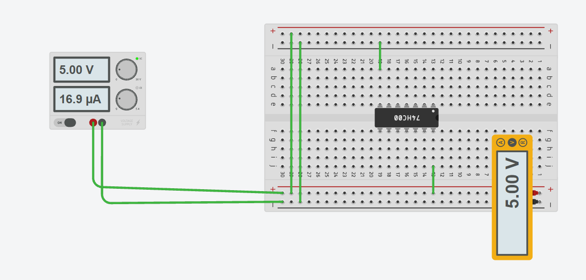

# 01 — NAND and AND gates

First logic gates on real hardware: a single gate from a 74LS00 (NAND), then the same wiring with a 74LS08 (AND).

## Goal

- Power a 74-series logic chip correctly and safely
- Verify a gate's full truth table on real hardware
- Show that chips with the same pinout can be swapped without rewiring

## Parts

| Part | Qty |
|------|-----|
| 74LS00 (quad 2-input NAND) | 1 |
| 74LS08 (quad 2-input AND) | 1 |
| LED | 1 |
| 1 kΩ resistor | 1 |
| MB102 breadboard power module (5 V) | 1 |
| Jumper wires | — |

## Wiring

| Signal | Chip pin |
|--------|----------|
| +5 V | 14 |
| GND | 7 |
| Input A | 1 |
| Input B | 2 |
| Output → LED → 1 kΩ → GND | 3 |

The 7400, 7408, 7432 and 7486 share this pinout, so swapping the 74LS00 for the 74LS08 needed no rewiring.

## Simulation

Power wiring checked in Tinkercad before building: bench supply into the rails, rails linked top to bottom, pin 7 to GND, pin 14 to +5 V, and the multimeter confirming 5.00 V.

Tinkercad has no 74LS parts, so the simulation uses the 74HC00. The pinout and logic are identical; only the electrical characteristics differ.

## Results

| A | B | NAND expected | NAND measured | AND expected | AND measured |
|:-:|:-:|:-------------:|:-------------:|:------------:|:------------:|
| 0 | 0 | 1 | ✅ ON | 0 | ✅ OFF |
| 0 | 1 | 1 | ✅ ON | 0 | ✅ OFF |
| 1 | 0 | 1 | ✅ ON | 0 | ✅ OFF |
| 1 | 1 | 0 | ✅ OFF | 1 | ✅ ON |

All 8 cases matched.

## Bugs I hit and how I found them

1. **Wrong adapter voltage.** I plugged a 24 V adapter into the power module, which is rated for about 6.5–12 V input, and likely damaged it. No chips were inserted yet, so nothing else was lost. *Fix:* replaced the module, and I now read the adapter label before connecting power.
2. **Rails at 3.3 V instead of 5 V.** The module's jumpers were set to 3.3 V. 74LS chips need 4.75–5.25 V. *Found by:* inspecting the jumpers before powering up.
3. **Rails at 4.6 V.** With a 6 V input, the module's regulator didn't have enough headroom, and the rails measured 4.6 V. *Found by:* measuring the rails with a multimeter. *Fix:* raised the input to 9 V, giving 5.0 V.
4. **Doubt about power polarity.** Before inserting the chip, I measured between the pin-14 row and the pin-7 row (+5 V confirmed) instead of relying on the breadboard's printed rail colours.

## What I learned

- Always measure the supply **before** inserting a chip.
- Pin 1 is next to the notch or dot; on 14-pin logic chips, pin 14 = +5 V and pin 7 = GND.
- Same pinout + different chip = different logic function.
