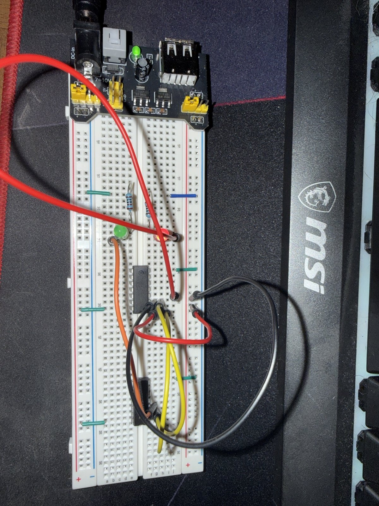
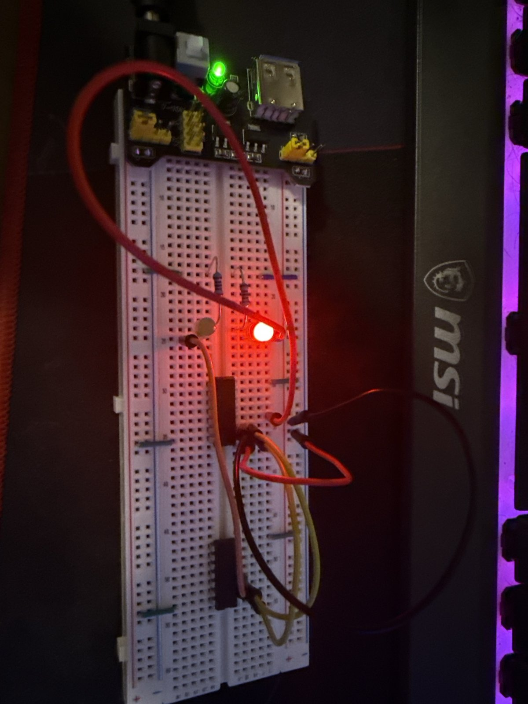
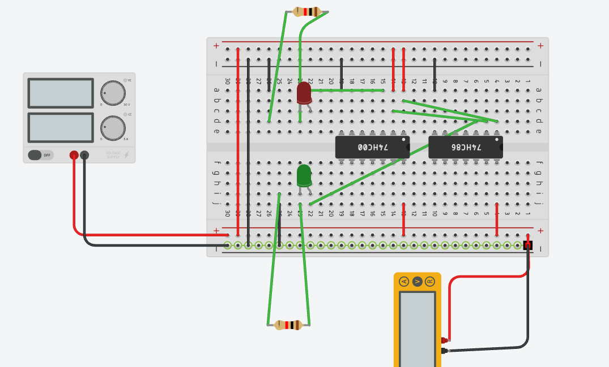

# 02 — Half adder

A circuit that adds two 1-bit numbers, built from one XOR gate (74LS86) and one AND gate (74LS08). This is the first building block of an ALU, the arithmetic unit inside every CPU and GPU.

## How it works

Adding two single bits gives a 2-bit result: a **sum** bit and a **carry** bit.

| A | B | A + B (binary) | Carry | Sum |
|:-:|:-:|:--------------:|:-----:|:---:|
| 0 | 0 | 00 | 0 | 0 |
| 0 | 1 | 01 | 0 | 1 |
| 1 | 0 | 01 | 0 | 1 |
| 1 | 1 | 10 | 1 | 0 |

- The **Sum** column is exactly XOR → `Sum = A ⊕ B`
- The **Carry** column is exactly AND → `Carry = A · B`

## Parts

| Part | Qty |
|------|-----|
| 74LS86 (quad 2-input XOR) | 1 |
| 74LS08 (quad 2-input AND) | 1 |
| LED | 2 |
| 1 kΩ resistor | 2 |
| MB102 breadboard power module (5 V) | 1 |
| Jumper wires | — |

## Wiring

| Signal | 74LS86 (XOR) | 74LS08 (AND) |
|--------|:------------:|:------------:|
| +5 V | pin 14 | pin 14 |
| GND | pin 7 | pin 7 |
| Input A | pin 1 | pin 1 |
| Input B | pin 2 | pin 2 |
| Output | pin 3 → **Sum** LED | pin 3 → **Carry** LED |

Each LED connects through a 1 kΩ resistor to GND. Inputs A and B are shared by both chips.

## Simulation

Simulated in Tinkercad with the 74HC86 and 74HC08 before building (same pinout and logic as the 74LS parts used in the real build). All 4 input combinations matched the truth table.

## Real build

| Wiring (power module at the top, two chips across the centre gap) | Running, with an output LED lit |
|:---:|:---:|
|  |  |

## Results

| A | B | Expected Carry | Measured Carry | Expected Sum | Measured Sum |
|:-:|:-:|:--------------:|:--------------:|:------------:|:------------:|
| 0 | 0 | 0 | ✅ 0 | 0 | ✅ 0 |
| 0 | 1 | 0 | ✅ 0 | 1 | ✅ 1 |
| 1 | 0 | 0 | ✅ 0 | 1 | ✅ 1 |
| 1 | 1 | 1 | ✅ 1 | 0 | ✅ 0 |

All 4 cases matched in simulation and on real hardware.

## Bugs I hit and how I found them

1. **Wrong chip in the simulation.** The "AND" chip was still a 74HC00 (NAND) from the previous build, so the Carry LED showed the inverted result (ON for 00, 01, 10 and OFF for 11). *Found by:* checking the part number on the chip against the design. *Fix:* replaced it with a 74HC08; no rewiring needed because the pinout is identical.

   

## What I learned

- XOR is the sum bit of binary addition, and AND is the carry bit.
- A circuit can "work" and still be wrong: always check part numbers, not just wiring.
- Simulating first, then building, made the real build work on the first try.

## Next step

A half adder has no **carry-in**, so it can only add the rightmost column of a number. Chaining two half adders and an OR gate gives a **full adder**, which can add multi-bit numbers.
